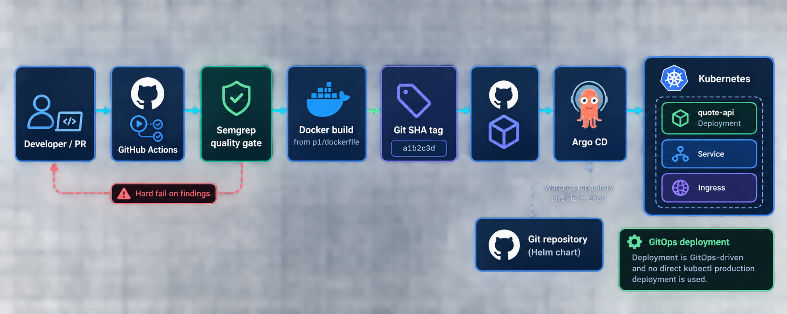

# GitLab CI to GitHub Actions Migration

## What changed

The workflow is `.github/workflows/ci.yml`.

## Migrated CI/CD flow



- The GitLab `sonar_check` job was replaced with a Semgrep scan. It runs on pull requests and pushes, uses the Python ruleset, and invokes `semgrep scan --error`, so findings fail the job. The old `allow_failure: true` behavior was intentionally removed.
- The legacy Node.js unit-test job was removed because this service is Python and has no Node package or npm test suite. The Python source is checked by Semgrep and the container build validates the runtime packaging.
- The Docker build now uses the actual Part 1 context (`p1`) and Dockerfile (`p1/dockerfile`) instead of the repository root.
- Images are pushed to GHCR, not GitLab’s registry.
- The image tag is the short Git commit SHA. No mutable `latest` tag is published.
- The deploy job was not copied. Deployment remains GitOps-managed by the Argo CD Application, which reconciles the Helm chart from the repository.
- The workflow uses GitHub’s built-in `GITHUB_TOKEN` with job-scoped `packages: write` permission instead of long-lived registry credentials.

## GitLab variable and secret migration

For a real migration, I would inventory every GitLab CI variable, classify it as configuration or secret, and move only secrets into GitHub Actions encrypted secrets or environment-level secrets:

| Legacy value | GitHub Actions destination | Notes |
|---|---|---|
| `CI_REGISTRY_USER` / `CI_REGISTRY_PASSWORD` | `GITHUB_TOKEN` plus `packages: write` | Prefer the short-lived repository token for GHCR. |
| `SONAR_HOST_URL` / `SONAR_TOKEN` | Environment secrets, if SonarCloud is selected | This workflow uses tokenless Semgrep instead. |
| `KUBECONFIG_CONTENT` | Deployment environment secret or, preferably, removed | Argo CD owns deployment; long-lived kubeconfigs should not be stored in CI. |
| AWS credentials | GitHub OIDC role assumption | Do not copy static access keys into repository secrets. |
| Image name and region | Workflow `env` or repository variables | Non-sensitive configuration does not need secret storage. |

Production deployments would use GitHub OIDC with short-lived cloud credentials and protected environments for any operation that changes infrastructure. Pull requests run the quality gate only; image publication occurs after the gate passes on the protected default branch.

## Verification

The quality gate can be reproduced locally with:

```bash
python -m pip install semgrep
semgrep scan --config p/python --error --metrics=off p1
```

The image build can be reproduced locally with:

```bash
docker build -f p1/dockerfile -t ghcr.io/tinhphamtrung04/assignment1:$(git rev-parse --short HEAD) p1
```
