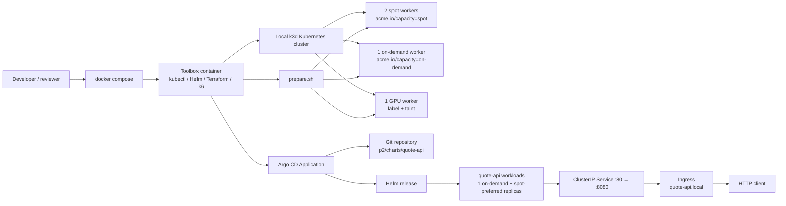
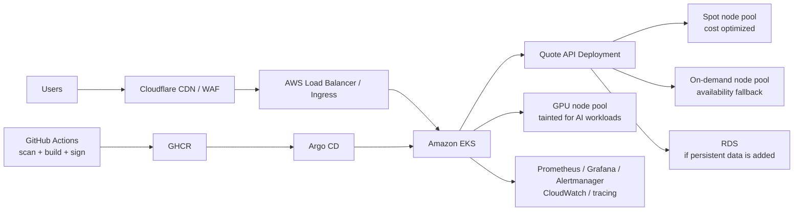

# Quote API — DevOps Take-Home

This repository deploys a small Python quote API to a local multi-node Kubernetes cluster using Argo CD and Helm. The deployment includes health probes, resource requests and limits, non-root execution, a read-only root filesystem, a Service, Ingress, HPA, and PodDisruptionBudget.

## Quick start

The intended reviewer flow is:

```bash
git clone <your-repo-url>
cd devops-takehome-package
docker compose up -d
./scripts/run-all.sh
```

The toolbox healthcheck becomes healthy only after the four-worker k3d cluster is reachable. `run-all.sh` uses `docker compose up -d --wait` internally and then performs an additional Kubernetes readiness check. If Compose must wait in the same manual command, use `docker compose up -d --wait`.

For the current toolbox workflow, run the numbered scripts inside the toolbox container:

```bash
docker compose up -d
docker exec -it k3d-toolbox bash

bash scripts/10-setup.sh
bash scripts/20-deploy.sh
bash scripts/25-reclaim-drill.sh
```

The application can then be checked through the local port-forward:

```bash
curl http://localhost:8080/api/quote
```

The Part 3 troubleshooting workflow is:

```bash
bash troubleshoot/prepare.sh
kubectl apply -f troubleshoot/broken-app.yaml
kubectl apply -f troubleshoot/fixed-app.yaml
./troubleshoot/verify.sh
```

## Architecture



Argo CD watches the repository path configured in `p2/deploy/argocd-app.yaml`, renders the Helm chart, and reconciles the application into the `default` namespace. The reclaim drill drains a spot node and verifies that the Service continues returning successful responses while Pods reschedule elsewhere.

## Script reference

| Script | Purpose | When to run |
|---|---|---|
| `scripts/run-all.sh` | Starts the toolbox and runs the complete local CORE flow from the repository root. | Golden Rule entrypoint. |
| `scripts/10-setup.sh` | Creates the local k3d cluster and prepares node labels/taints. | First cluster setup. |
| `scripts/20-deploy.sh` | Installs Argo CD, applies the Argo CD Application, waits for the API rollout, and checks the API. | After cluster setup. |
| `troubleshoot/prepare.sh` | Labels two spot nodes, one on-demand node, and taints the GPU node. | After cluster creation. |
| `troubleshoot/verify.sh` | Verifies Part 3 workloads, node placement, Service endpoints, NetworkPolicy, and smoke test. | After applying the fixed manifests. |
| `scripts/25-reclaim-drill.sh` | Drains a spot node and verifies Service availability and rescheduling. | After Argo CD deployment. |
| `scripts/99-cleanup.sh` | Deletes the local k3d cluster, toolbox container, Compose resources, and project volumes. | When tearing down the local environment. |

## Design decisions and trade-offs

- The application uses Python’s standard-library HTTP server to keep the runtime small and dependency-free.
- The image runs as a non-root user and Kubernetes additionally enforces a non-root UID, privilege escalation disabled, and read-only root filesystem.
- Health and readiness probes use separate `/healthz` and `/readyz` endpoints so Kubernetes can distinguish process liveness from traffic readiness.
- The Service is internal by default (`ClusterIP`); external access is represented by the Ingress, while local scripts use port-forwarding or an in-cluster Service check.
- The chart keeps one baseline replica on an on-demand node with required affinity, while a separate spot-preferred workload supplies the remaining capacity and can fall back to on-demand. Both workloads share the Service; the HPA scales the spot-preferred workload without removing the on-demand baseline.
- The reclaim test uses an in-cluster curl Pod instead of relying on a host-side port-forward. A Service port-forward can disconnect when its selected backend Pod is evicted even though the Service is healthy.
- The Part 3 fix preserves the provided default-deny NetworkPolicy and adds only DNS and smoke-client-to-web exceptions.
- The local harness is intentionally lightweight and does not reproduce cloud load balancers, managed node groups, or cloud identity providers.

## Reviewer troubleshooting notes

- **Docker resources:** k3d with four workers plus Argo CD needs sufficient CPU and memory. Increase Docker Desktop resources if Pods remain Pending.
- **Port conflicts:** port `8080` is used by the local verification port-forward. Stop another process using it or change the local port mapping in the script.
- **Architecture/image pulls:** on ARM hosts, use images with a matching multi-architecture manifest and check `kubectl describe pod` for `ImagePullBackOff` or architecture errors.
- **kubectl context:** confirm the local cluster is selected with `kubectl config current-context` before running the scripts. The scripts must not accidentally target a remote EKS context.

## Production-oriented AWS design (bonus)



In production, Argo CD remains the deployment control plane, with separate node pools for cost-sensitive workloads, availability-critical fallback capacity, and tainted GPU workloads. Cloudflare provides the public edge, while observability collects application metrics, Kubernetes health, and deployment signals.

## Current scope

Core application, Helm/Argo CD deployment, reclaim drill, Part 3 troubleshooting artifacts, the Part 4 GitHub Actions migration, and the required Part 7 operations are included. Parts 5 and 6 are intentionally not included because the assignment requires selecting at least one of Parts 4–6.
